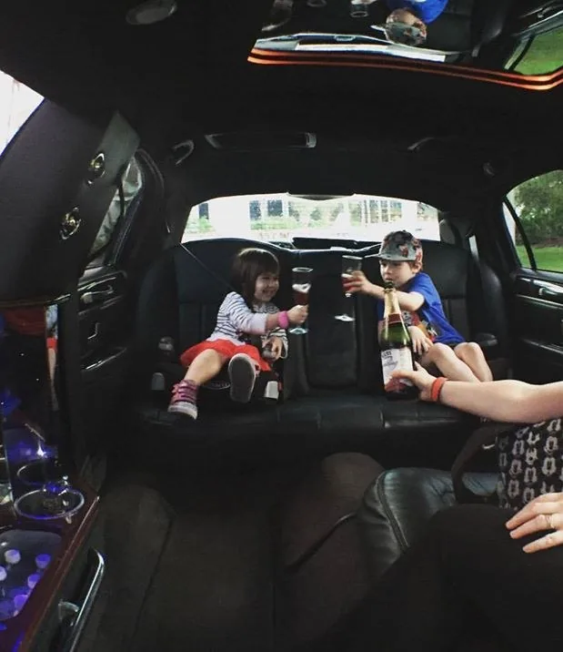

# Stretchgood

## Every kid deserves a first limo ride.

Years ago, our founder Daniel Shanklin took his kids to Disney in a stretch limo. Somebody poured them fake champagne, and they raised their glasses in the back like it was the biggest night of their lives. For a few minutes, they were the most special people in the world.

That feeling is what we're here for. It's not about the car. It's the moment a kid climbs in, looks around, and realizes tonight is about them.

Plenty of kids never get that night, whether it's prom, a big milestone, or a wish they've waited a long time for. Stretchgood gives free limo rides, with no fares, no tips and no gas money, so they can. When someone has a big night, the community shows up.

*Daniel's kids on their first limo ride.*

> **V1 · figures are estimates.** Images other than the opening family photo are generated concept art.

*Planned · Fort Worth, Texas · Not operating yet*

Free stretch-limo rides for the big nights that mark growing up. A community that shows up. Read the plan section by section below.

## Where it stands

Stretchgood is a plan, not a running service. It is not giving rides, has no established 501(c)(3) status, and has no partner commitments. Nothing here can be booked or donated to, and no ride is promised.

## Sections

1. **Mission**: What Stretchgood exists to do: preserve a part of ordinary life we could lose, the big nights that mark growing up, with free stretch-limo rides. → https://shanklin.ai/stretchgood/mission/ ([markdown](/stretchgood/mission.md))
2. **Why**: Why the big nights matter, why they could be lost, and why a free limo ride is the way Stretchgood answers that. → https://shanklin.ai/stretchgood/why/ ([markdown](/stretchgood/why.md))
3. **Plan**: How Stretchgood gets from a plan to a first ride: who it serves and in what order, who it works with, and who drives. → https://shanklin.ai/stretchgood/plan/ ([markdown](/stretchgood/plan.md))
4. **Financials**: What it costs to start and to keep running, line by line, with unknowns marked and every total labeled as an estimate. → https://shanklin.ai/stretchgood/financials/ ([markdown](/stretchgood/financials.md))
5. **Fundraising**: How the startup and ongoing money will be raised. Stretchgood is not taking donations yet. → https://shanklin.ai/stretchgood/fundraising/ ([markdown](/stretchgood/fundraising.md))
6. **What we need to buy**: The vehicle and everything that comes with it: the reference listing, the checks before any purchase, and the shopping list. → https://shanklin.ai/stretchgood/what-we-need-to-buy/ ([markdown](/stretchgood/what-we-need-to-buy.md))
7. **Open decisions**: Everything still to settle before the first ride, in one list. → https://shanklin.ai/stretchgood/open-decisions/ ([markdown](/stretchgood/open-decisions.md))
8. **Follow along**: Where updates to the plan will live and how to keep up. No sign-up, booking, or donation form. → https://shanklin.ai/stretchgood/follow-along/ ([markdown](/stretchgood/follow-along.md))

---

Sponsored by [Daniel Shanklin](https://shanklin.ai/)
